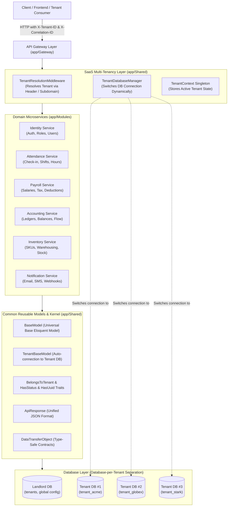

# 🚀 Laravel Microservice Architecture, SaaS Multi-Tenancy & API Gateway

A robust, enterprise-grade **Modular Microservice, SaaS Multi-Tenancy (Database-per-Tenant), & API Gateway** implemented in Laravel (PHP 8.4). Designed as a clean **Modular Monolith** that encapsulates bounded contexts, maintains high cohesion and loose coupling, provides a common reusable core (`BaseModel`, `TenantBaseModel`, traits, database managers), and is ready for distributed deployment.

---

## 📑 Table of Contents

- [Architecture Overview](#-architecture-overview)
- [SaaS Multi-Tenancy & Database Separation](#-saas-multi-tenancy--database-separation)
- [Common Reusable Core Architecture](#-common-reusable-core-architecture)
- [Directory Structure](#-directory-structure)
- [System Requirements & Prerequisites](#-system-requirements--prerequisites)
- [Full Installation & Run Process](#-full-installation--run-process)
- [API Gateway Features](#-api-gateway-features)
- [SaaS Tenant Management Endpoints](#-saas-tenant-management-endpoints)
- [Field-Level Code & Data Dictionary](#-field-level-code--data-dictionary)
  - [1. API Gateway Endpoints](#1-api-gateway-endpoints)
  - [2. Identity Microservice](#2-identity-microservice)
  - [3. Attendance Microservice](#3-attendance-microservice)
  - [4. Payroll Microservice](#4-payroll-microservice)
  - [5. Accounting Microservice](#5-accounting-microservice)
  - [6. Inventory Microservice](#6-inventory-microservice)
  - [7. Notification Microservice](#7-notification-microservice)
- [cURL Test Commands](#-curl-test-commands)
- [Automated Testing & Code Quality](#-automated-testing--code-quality)

---

## 🏛 Architecture Overview



---

## 🏢 SaaS Multi-Tenancy & Database Separation

This project is built from the ground up for **SaaS applications** with strict tenant isolation:

1. **Database-Per-Tenant Separation**:
   - Each SaaS subscriber/organization can have its own dedicated database (e.g. `tenant_acme`, `tenant_globex`, `tenant_stark`).
   - Prevents cross-tenant data leaks and enables compliance with enterprise security requirements.
2. **Dynamic Connection Pool Switching (`TenantDatabaseManager`)**:
   - The landlord database maintains the tenant registry (`tenants` table).
   - Upon receiving an incoming request, `TenantResolutionMiddleware` detects the tenant via:
     - Header: `X-Tenant-ID: acme`
     - Subdomain: `acme.domain.com`
     - Query Parameter: `?tenant_id=acme`
   - `TenantDatabaseManager::connect($tenant)` dynamically configures and purges the `'tenant'` database connection at runtime without server restart.
3. **Response Transparency**:
   - Every API response includes `X-Tenant-ID` and `X-Tenant-Database` response headers confirming which tenant database served the request.

---

## 🧩 Common Reusable Core Architecture

All common, reusable classes reside in `app/Shared/` so that modules never duplicate boilerplate:

| Component | Path | Description |
|---|---|---|
| **BaseModel** | `app/Shared/Models/BaseModel.php` | Root abstract Eloquent model with ISO-8601 date serialization, `scopeRecent()`, `scopeActive()`, `scopeSearch()`, and status checks. |
| **TenantBaseModel** | `app/Shared/Models/TenantBaseModel.php` | Base model for tenant-specific domain entities. Automatically resolves its database connection to the active tenant's database connection. |
| **Tenant** | `app/Shared/Models/Tenant.php` | Landlord model representing SaaS Tenants (`id`, `name`, `subdomain`, `database_name`, `status`, `plan`). |
| **BelongsToTenant** | `app/Shared/Traits/BelongsToTenant.php` | Trait providing global tenant query scoping and auto-assignment of `tenant_id` on creation. |
| **HasStatus** | `app/Shared/Traits/HasStatus.php` | Trait providing `scopeActive()`, `scopeStatus()`, and `isActive()` checks. |
| **HasUuid** | `app/Shared/Traits/HasUuid.php` | Trait auto-generating UUIDs and providing `scopeWhereUuid()`. |
| **TenantDatabaseManager** | `app/Shared/Database/TenantDatabaseManager.php` | Dynamically manages, purges, and reconnects tenant database connections at runtime. |
| **TenantResolutionMiddleware** | `app/Shared/Middleware/TenantResolutionMiddleware.php` | Resolves tenant from headers or subdomains and activates the tenant context. |
| **TenantContext** | `app/Shared/Support/TenantContext.php` | Singleton retaining the current tenant metadata throughout the HTTP request lifecycle. |
| **ApiResponse** | `app/Shared/Support/ApiResponse.php` | Standardized JSON API response handler (`success`, `error`, `paginated`). |
| **DataTransferObject** | `app/Shared/Support/DataTransferObject.php` | Abstract contract for immutable, type-safe DTOs with `JsonSerializable`. |

All module models inherit from this common foundation:
- `IdentityUser` extends `Authenticatable` and uses `BelongsToTenant`, `HasStatus`, and dynamic tenant connection resolution.
- `AttendanceRecord` extends `TenantBaseModel`
- `PayrollRecord` extends `TenantBaseModel`
- `AccountLedger` extends `TenantBaseModel`
- `InventoryItem` extends `TenantBaseModel`
- `NotificationLog` extends `TenantBaseModel`

---

## 📂 Directory Structure

```text
app/
├── Gateway/                                 # API Gateway Core Layer
│   ├── Controllers/
│   │   └── GatewayController.php            # Gateway endpoints (overview, dashboard, dispatch, docs)
│   ├── Middleware/
│   │   └── GatewayCorrelationIdMiddleware.php # Injects & echoes unique X-Correlation-ID
│   ├── Services/
│   │   └── GatewayService.php               # Service aggregation, dynamic dispatching, schema generator
│   └── routes.php                           # Gateway route definitions
│
├── Modules/                                 # Independent Microservice Modules
│   ├── Identity/                            # Identity & Access Management
│   │   ├── Controllers/IdentityController.php
│   │   ├── Services/IdentityService.php
│   │   ├── DTOs/IdentityDTO.php
│   │   ├── Models/IdentityUser.php          # Uses Common BelongsToTenant & Dynamic Connection
│   │   ├── Requests/IdentityIndexRequest.php
│   │   └── routes.php
│   ├── Attendance/                          # Attendance & Shift Management
│   │   ├── Controllers/AttendanceController.php
│   │   ├── Services/AttendanceService.php
│   │   ├── DTOs/AttendanceDTO.php
│   │   ├── Models/AttendanceRecord.php      # Extends Common TenantBaseModel
│   │   ├── Requests/AttendanceIndexRequest.php
│   │   └── routes.php
│   ├── Payroll/                             # Compensation & Payroll Processing
│   │   ├── Controllers/PayrollController.php
│   │   ├── Services/PayrollService.php
│   │   ├── DTOs/PayrollDTO.php
│   │   ├── Models/PayrollRecord.php         # Extends Common TenantBaseModel
│   │   ├── Requests/PayrollIndexRequest.php
│   │   └── routes.php
│   ├── Accounting/                          # Double-Entry Ledger & Financials
│   │   ├── Controllers/AccountingController.php
│   │   ├── Services/AccountingService.php
│   │   ├── DTOs/AccountingDTO.php
│   │   ├── Models/AccountLedger.php         # Extends Common TenantBaseModel
│   │   ├── Requests/AccountingIndexRequest.php
│   │   └── routes.php
│   ├── Inventory/                           # Stock & Warehouse Management
│   │   ├── Controllers/InventoryController.php
│   │   ├── Services/InventoryService.php
│   │   ├── DTOs/InventoryDTO.php
│   │   ├── Models/InventoryItem.php         # Extends Common TenantBaseModel
│   │   ├── Requests/InventoryIndexRequest.php
│   │   └── routes.php
│   └── Notification/                        # Multi-Channel Dispatch & Logs
│       ├── Controllers/NotificationController.php
│       ├── Services/NotificationService.php
│       ├── DTOs/NotificationDTO.php
│       ├── Models/NotificationLog.php       # Extends Common TenantBaseModel
│       ├── Requests/NotificationIndexRequest.php
│       └── routes.php
│
├── Shared/                                  # Common Reusable Core & SaaS Multi-Tenancy
│   ├── Controllers/
│   │   └── TenantController.php             # Landlord tenant provisioning & context endpoints
│   ├── Database/
│   │   └── TenantDatabaseManager.php        # Dynamic multi-tenant DB connections & switching
│   ├── Exceptions/
│   │   ├── ModuleException.php              # Domain exception with unified JSON rendering
│   │   └── TenantNotFoundException.php      # Thrown when tenant cannot be resolved
│   ├── Middleware/
│   │   └── TenantResolutionMiddleware.php   # Detects tenant via X-Tenant-ID / Subdomain and sets DB connection
│   ├── Models/
│   │   ├── BaseModel.php                    # Universal Base Eloquent Model
│   │   ├── Tenant.php                       # Landlord SaaS Tenant Model
│   │   └── TenantBaseModel.php              # Tenant-scoped Base Model with auto DB switching
│   ├── Support/
│   │   ├── ApiResponse.php                  # Standardized response helper (success, error, paginated)
│   │   ├── DataTransferObject.php           # Abstract DTO contract with JsonSerializable
│   │   └── TenantContext.php                # Singleton storing current active tenant state
│   └── Traits/
│       ├── BelongsToTenant.php              # Tenant scoping and auto-assignment
│       ├── HasStatus.php                    # Status scopes and helpers
│       └── HasUuid.php                      # UUID generation and query helpers
│
└── Providers/
    ├── AppServiceProvider.php
    └── ModuleServiceProvider.php            # Auto-registers module routes, gateway, tenants & discovery
```

---

## ⚙ System Requirements & Prerequisites

- **PHP**: `^8.3` or `^8.4` (Installed: PHP 8.4.12)
- **PHP Extensions**: `openssl`, `pdo`, `pdo_mysql`, `pdo_sqlite`, `mbstring`, `curl`, `intl`, `fileinfo`, `gd`, `zip`
- **Composer**: `^2.x`
- **Database**: MySQL 8.x (e.g. Laragon default) or SQLite (in-memory for automated tests)
- **Web Server**: Laragon / Apache / Nginx or PHP built-in CLI server

---

## 🏃 Full Installation & Run Process

### Step 1: Clone or Open Workspace
```bash
cd /d/laragon/www/laravel-microservice/laravel-microservice
```

### Step 2: Configure Environment Variables
```bash
cp .env.example .env
```
Ensure your database credentials in `.env` match your local environment:
```ini
APP_NAME=LaravelMicroservice
APP_ENV=local
APP_KEY=
APP_DEBUG=true
APP_URL=http://localhost:8000

DB_CONNECTION=mysql
DB_HOST=127.0.0.1
DB_PORT=3306
DB_DATABASE=laravel_microservice
DB_USERNAME=root
DB_PASSWORD=
```

### Step 3: Install Composer Dependencies
```bash
composer install
```
*(If running under Laragon where composer is a phar file:)*
```bash
php D:\laragon\bin\composer\composer.phar install
```

### Step 4: Generate Application Encryption Key
```bash
php artisan key:generate
```

### Step 5: Run Database Migrations
```bash
php artisan migrate
```

### Step 6: Start the Application Server

#### Option A: VS Code One-Click Compound Task (⭐ Recommended for Multi-Port)
Open VS Code, press **`Ctrl+Shift+B`** (or press `F1` / `Ctrl+Shift+P` -> **Tasks: Run Task** -> **Run All Microservices (Ports 8000-8006)**).
This immediately launches all 7 microservices in parallel in separate terminal tabs:
- **Port 8000**: API Gateway (Public Root Entrypoint)
- **Port 8001**: Identity Microservice
- **Port 8002**: Attendance Microservice
- **Port 8003**: Payroll Microservice
- **Port 8004**: Accounting Microservice
- **Port 8005**: Inventory Microservice
- **Port 8006**: Notification Microservice

#### Option B: PowerShell Multi-Window Script
```powershell
.\start-services.ps1
```

#### Option C: PHP Built-in Server (Unified Single Port)
```bash
php artisan serve --port=8000
```
The application will be accessible at: `http://127.0.0.1:8000`

#### Option D: Laragon Local Virtual Host
If using Laragon, start Apache & MySQL. Access via:
`http://laravel-microservice.test`

---

## 🔒 Zero-Trust Security: Gateway-Only Access Protection

In this microservice architecture, **backend microservice ports (8001–8006) cannot be accessed directly by external clients**. Direct requests are rejected with `403 Forbidden`:

```json
{
  "success": false,
  "message": "Direct microservice access denied. All requests must route through the API Gateway.",
  "errors": {
    "reason": "Direct port access is blocked for security.",
    "gateway_entrypoint": "http://127.0.0.1:8000/api/gateway/dispatch/identity",
    "hint": "Send your request to the API Gateway at port 8000, or provide the internal X-Gateway-Secret header."
  }
}
```

### How It Works:
1. All client traffic enters exclusively through **API Gateway (Port 8000)**.
2. The Gateway securely dispatches requests to individual service ports (8001–8006) by signing requests with the internal `X-Gateway-Secret` header configured in `.env`.
3. The `EnsureGatewayAccess` middleware on each service verifies this signature. Unsigned direct external requests are instantly blocked.

### Service URLs in `.env`:
```ini
MICROSERVICE_GATEWAY_MODE=http
GATEWAY_INTERNAL_SECRET=microservice_internal_secret_key_987456321

GATEWAY_URL=http://127.0.0.1:8000
IDENTITY_SERVICE_URL=http://127.0.0.1:8001
ATTENDANCE_SERVICE_URL=http://127.0.0.1:8002
PAYROLL_SERVICE_URL=http://127.0.0.1:8003
ACCOUNTING_SERVICE_URL=http://127.0.0.1:8004
INVENTORY_SERVICE_URL=http://127.0.0.1:8005
NOTIFICATION_SERVICE_URL=http://127.0.0.1:8006
```

---

## 🏢 SaaS Tenant Management Endpoints

The Landlord layer (`app/Shared/Controllers/TenantController.php`) provides full SaaS tenant control:

| Endpoint | Method | Header | Description |
|---|---|---|---|
| `/api/tenants` | `GET` | — | List all registered SaaS tenants and their database separation configuration. |
| `/api/tenants/current` | `GET` | `X-Tenant-ID: {subdomain}` | Inspect current resolved tenant context and active database name. |
| `/api/tenants` | `POST` | — | Provision a new SaaS tenant with a dedicated separate database. |

##### Example Tenant Registration Payload:
```json
{
  "name": "Wayne Enterprises",
  "subdomain": "wayne",
  "plan": "enterprise"
}
```

---

## 🌐 API Gateway Features

The **API Gateway** (`app/Gateway`) provides centralized orchestration for all microservices:

1. **Correlation ID Tracking (`X-Correlation-ID`)**:
   - Every request is tagged with an incoming or auto-generated UUID in `X-Correlation-ID`.
2. **Tenant Resolution (`X-Tenant-ID`)**:
   - Seamlessly resolves the calling organization and switches to their separate database.
3. **Cluster Health & Telemetry (`GET /api/gateway/overview`)**:
   - Collects live response latency (in ms), service operational status, version, and feature flags.
4. **Aggregator Pattern (`GET /api/gateway/dashboard/{employeeId}`)**:
   - In a single HTTP trip, stitches together:
     - Identity profile
     - Daily Attendance status & hours
     - Active Payroll slip & net compensation
     - Recent alerts & notifications
5. **Dynamic Dispatcher (`GET|POST /api/gateway/dispatch/{service}`)**:
   - Reverse-proxies calls to any microservice (`identity`, `attendance`, `payroll`, `accounting`, `inventory`, `notification`) while attaching timing, tenant, and correlation headers.
6. **Interactive Schema Documentation (`GET /api/gateway/docs`)**:
   - Returns real-time JSON OpenAPI schema and field-level metadata for every service.

---

## 📖 Field-Level Code & Data Dictionary

All microservice responses follow the standardized **ApiResponse** format:
```json
{
  "success": true,
  "message": "Operation successful",
  "data": { ... },
  "meta": { ... }
}
```

---

### 1. API Gateway Endpoints

#### `GET /api/gateway/overview`
Returns live status, cluster latency, and registered microservices.

##### Response Fields:
| Field Name | Type | Description | Example |
|---|---|---|---|
| `gateway.name` | `string` | Title of the API Gateway | `"Laravel Microservice API Gateway"` |
| `gateway.version` | `string` | Semantic release version | `"1.0.0"` |
| `gateway.status` | `string` | Operational state | `"healthy"` |
| `gateway.cluster_latency_ms` | `float` | Round-trip polling time in ms | `1.45` |
| `gateway.total_services` | `int` | Number of microservices registered | `6` |
| `gateway.active_services` | `int` | Number of healthy services | `6` |
| `services` | `object` | Map of each microservice's health payload | `{ "identity": {...}, ... }` |

---

#### `GET /api/gateway/dashboard/{employeeId}`
Aggregated 360-degree employee view combining **Identity**, **Attendance**, **Payroll**, and **Notification**.

##### URL Parameters:
| Parameter | Type | Required | Description | Example |
|---|---|---|---|---|
| `employeeId` | `int` | Yes | Target Employee Identifier | `1` |

##### Response Fields:
| Field Name | Type | Description | Example |
|---|---|---|---|
| `aggregated_at` | `string (ISO-8601)` | Timestamp when data was stitched | `"2026-10-29T11:15:00Z"` |
| `employee.id` | `int` | Employee identity ID | `1` |
| `employee.name` | `string` | Employee full name | `"Alice Morgan"` |
| `employee.email` | `string` | Employee corporate email | `"alice@company.com"` |
| `employee.role` | `string` | Access tier role | `"Admin"` |
| `attendance.status` | `string` | Today's attendance flag | `"present"` |
| `attendance.check_in` | `string` | Recorded check-in time | `"2026-10-29 08:55:00"` |
| `attendance.work_hours` | `float` | Working hours counted | `8.16` |
| `payroll.month` | `string` | Current billing period | `"2026-10"` |
| `payroll.net_salary` | `float` | Net take-home pay | `6950.00` |
| `payroll.status` | `string` | Disbursement status | `"paid"` |
| `notifications` | `array` | List of latest notification objects | `[...]` |

---

### 2. Identity Microservice

- **Index Endpoint**: `GET /api/identity`
- **Health Endpoint**: `GET /api/identity/health`
- **Model**: `App\Modules\Identity\Models\IdentityUser` (Uses Common `BelongsToTenant`)
- **DTO**: `App\Modules\Identity\DTOs\IdentityDTO`

##### Query Parameters:
| Parameter | Type | Rule | Description |
|---|---|---|---|
| `search` | `string` | nullable, max:100 | Searches in `name` or `email` |
| `role` | `string` | in:Admin,Manager,User | Filters by role |
| `status` | `string` | in:active,inactive | Filters by account state |

##### Field Definitions:
| Field | Type | Required | Description | Example |
|---|---|---|---|---|
| `id` | `int` | Yes | Unique database user identifier | `1` |
| `tenant_id` | `int` | No | SaaS Tenant Organization ID | `1` |
| `name` | `string` | Yes | User display name | `"System Administrator"` |
| `email` | `string (email)` | Yes | Unique contact email | `"admin@example.com"` |
| `role` | `string` | Yes | Access role level (`Admin`, `Manager`, `User`) | `"Admin"` |
| `status` | `string` | Yes | Account status (`active`, `inactive`) | `"active"` |
| `created_at` | `string (ISO-8601)` | No | Timestamp account was created | `"2026-10-29T10:00:00Z"` |

---

### 3. Attendance Microservice

- **Index Endpoint**: `GET /api/attendance`
- **Health Endpoint**: `GET /api/attendance/health`
- **Model**: `App\Modules\Attendance\Models\AttendanceRecord` (Extends `TenantBaseModel`)
- **DTO**: `App\Modules\Attendance\DTOs\AttendanceDTO`

##### Query Parameters:
| Parameter | Type | Rule | Description |
|---|---|---|---|
| `date` | `string` | nullable, format:YYYY-MM-DD | Target calendar date |
| `status` | `string` | in:present,late,absent,on_leave | Filter by status |
| `employee_id` | `int` | nullable, integer | Filter by employee ID |

##### Field Definitions:
| Field | Type | Required | Description | Example |
|---|---|---|---|---|
| `id` | `int` | Yes | Unique attendance record ID | `101` |
| `tenant_id` | `int` | No | Tenant identifier for data isolation | `1` |
| `employee_id` | `int` | Yes | Foreign employee identifier | `1` |
| `employee_name` | `string` | Yes | Name of the employee | `"Alice Morgan"` |
| `check_in` | `string` | Yes | Clock-in datetime timestamp | `"2026-10-29 08:55:00"` |
| `check_out` | `string` | No | Clock-out datetime timestamp | `"2026-10-29 17:05:00"` |
| `status` | `string` | Yes | Attendance flag (`present`, `late`, `absent`, `on_leave`) | `"present"` |
| `work_hours` | `float` | Yes | Calculated day work duration in hours | `8.16` |

---

### 4. Payroll Microservice

- **Index Endpoint**: `GET /api/payroll`
- **Health Endpoint**: `GET /api/payroll/health`
- **Model**: `App\Modules\Payroll\Models\PayrollRecord` (Extends `TenantBaseModel`)
- **DTO**: `App\Modules\Payroll\DTOs\PayrollDTO`

##### Query Parameters:
| Parameter | Type | Rule | Description |
|---|---|---|---|
| `month` | `string` | regex: `^\d{4}-(0[1-9]\|1[0-2])$` | Target year-month cycle |
| `status` | `string` | in:draft,processed,paid | Filter by disbursement state |
| `employee_id` | `int` | nullable, integer | Filter by employee ID |

##### Field Definitions:
| Field | Type | Required | Description | Example |
|---|---|---|---|---|
| `id` | `int` | Yes | Unique payroll slip number | `501` |
| `tenant_id` | `int` | No | Associated tenant organization ID | `1` |
| `employee_id` | `int` | Yes | Associated employee identifier | `1` |
| `employee_name` | `string` | Yes | Full employee name | `"Alice Morgan"` |
| `month` | `string` | Yes | Billing period cycle | `"2026-10"` |
| `basic_salary` | `float` | Yes | Base gross salary before addons | `6500.00` |
| `allowances` | `float` | Yes | Bonuses and performance additions | `1200.00` |
| `deductions` | `float` | Yes | Income tax, health insurance, provident fund | `750.00` |
| `net_salary` | `float` | Yes | Final payable amount (`basic + allowances - deductions`) | `6950.00` |
| `status` | `string` | Yes | Status (`draft`, `processed`, `paid`) | `"paid"` |

---

### 5. Accounting Microservice

- **Index Endpoint**: `GET /api/accounting`
- **Health Endpoint**: `GET /api/accounting/health`
- **Model**: `App\Modules\Accounting\Models\AccountLedger` (Extends `TenantBaseModel`)
- **DTO**: `App\Modules\Accounting\DTOs\AccountingDTO`

##### Query Parameters:
| Parameter | Type | Rule | Description |
|---|---|---|---|
| `type` | `string` | in:asset,liability,equity,revenue,expense | Chart category |
| `search` | `string` | nullable, max:100 | Searches in `account_code` or `account_name` |

##### Field Definitions:
| Field | Type | Required | Description | Example |
|---|---|---|---|---|
| `id` | `int` | Yes | Ledger account record ID | `1` |
| `tenant_id` | `int` | No | Associated tenant organization ID | `1` |
| `account_code` | `string` | Yes | Chart of Accounts standard code | `"AC-1001"` |
| `account_name` | `string` | Yes | Title of the ledger account | `"Main Operating Cash Account"` |
| `type` | `string` | Yes | Accounting category (`asset`, `liability`, `equity`, `revenue`, `expense`) | `"asset"` |
| `balance` | `float` | Yes | Real-time ledger running balance | `148500.50` |
| `currency` | `string` | Yes | 3-letter currency code | `"USD"` |

---

### 6. Inventory Microservice

- **Index Endpoint**: `GET /api/inventory`
- **Health Endpoint**: `GET /api/inventory/health`
- **Model**: `App\Modules\Inventory\Models\InventoryItem` (Extends `TenantBaseModel`)
- **DTO**: `App\Modules\Inventory\DTOs\InventoryDTO`

##### Query Parameters:
| Parameter | Type | Rule | Description |
|---|---|---|---|
| `category` | `string` | nullable, max:50 | Product category classification |
| `status` | `string` | in:in_stock,low_stock,out_of_stock | Stock health condition |
| `search` | `string` | nullable, max:100 | Searches in `name` or `sku` |

##### Field Definitions:
| Field | Type | Required | Description | Example |
|---|---|---|---|---|
| `id` | `int` | Yes | Item database ID | `1` |
| `tenant_id` | `int` | No | Associated tenant organization ID | `1` |
| `sku` | `string` | Yes | Stock Keeping Unit code | `"SKU-LAP-M3P"` |
| `name` | `string` | Yes | Product catalog title | `"Apple MacBook Pro 16\" M3 Pro"` |
| `category` | `string` | Yes | Category classification | `"Hardware"` |
| `quantity` | `int` | Yes | Physical inventory units available | `45` |
| `unit_price` | `float` | Yes | Retail unit sales price | `2499.00` |
| `status` | `string` | Yes | Inventory alert status (`in_stock`, `low_stock`, `out_of_stock`) | `"in_stock"` |

---

### 7. Notification Microservice

- **Index Endpoint**: `GET /api/notification`
- **Health Endpoint**: `GET /api/notification/health`
- **Model**: `App\Modules\Notification\Models\NotificationLog` (Extends `TenantBaseModel`)
- **DTO**: `App\Modules\Notification\DTOs\NotificationDTO`

##### Query Parameters:
| Parameter | Type | Rule | Description |
|---|---|---|---|
| `channel` | `string` | in:email,sms,push,webhook | Filter by transmission channel |
| `status` | `string` | in:pending,delivered,failed | Filter by delivery receipt |
| `recipient` | `string` | nullable, max:100 | Substring search on recipient target |

##### Field Definitions:
| Field | Type | Required | Description | Example |
|---|---|---|---|---|
| `id` | `int` | Yes | Notification log record ID | `1` |
| `tenant_id` | `int` | No | Associated tenant organization ID | `1` |
| `recipient` | `string` | Yes | Target destination (email, phone, webhook endpoint) | `"admin@company.com"` |
| `channel` | `string` | Yes | Transmission method (`email`, `sms`, `push`, `webhook`) | `"email"` |
| `title` | `string` | Yes | Message subject / title | `"Monthly Financial Audit Ready"` |
| `content` | `string` | Yes | Full message text content | `"The consolidated accounting reports for Q3 have been generated."` |
| `status` | `string` | Yes | Dispatch state (`pending`, `delivered`, `failed`) | `"delivered"` |
| `sent_at` | `string (ISO-8601)` | No | Timestamp of message dispatch | `"2026-10-29T10:30:00Z"` |

---

## ⚡ cURL Test Commands

Test all endpoints directly via command-line:

```bash
# 1. SaaS Multi-Tenancy - List Registered Tenants & Database Config
curl -X GET "http://127.0.0.1:8000/api/tenants" -H "Accept: application/json"

# 2. SaaS Multi-Tenancy - Check Current Resolved Tenant (Passing Tenant Header)
curl -X GET "http://127.0.0.1:8000/api/tenants/current" \
  -H "Accept: application/json" \
  -H "X-Tenant-ID: acme"

# 3. SaaS Multi-Tenancy - Register New Tenant With Dedicated Separate Database
curl -X POST "http://127.0.0.1:8000/api/tenants" \
  -H "Accept: application/json" \
  -H "Content-Type: application/json" \
  -d '{"name":"Wayne Enterprises","subdomain":"wayne","plan":"enterprise"}'

# 4. API Gateway - Cluster Overview & Telemetry (With Tenant & Correlation Headers)
curl -X GET "http://127.0.0.1:8000/api/gateway/overview" \
  -H "Accept: application/json" \
  -H "X-Tenant-ID: acme"

# 5. API Gateway - Aggregated Employee 360 Dashboard
curl -X GET "http://127.0.0.1:8000/api/gateway/dashboard/1" \
  -H "Accept: application/json" \
  -H "X-Tenant-ID: globex"

# 6. API Gateway - Dynamic Dispatch to Attendance Service
curl -X GET "http://127.0.0.1:8000/api/gateway/dispatch/attendance?status=present" \
  -H "Accept: application/json" \
  -H "X-Tenant-ID: stark"

# 7. Direct Microservice Endpoints With Tenant Scoping
curl -X GET "http://127.0.0.1:8000/api/identity" -H "X-Tenant-ID: acme"
curl -X GET "http://127.0.0.1:8000/api/attendance" -H "X-Tenant-ID: acme"
curl -X GET "http://127.0.0.1:8000/api/payroll" -H "X-Tenant-ID: acme"
curl -X GET "http://127.0.0.1:8000/api/accounting" -H "X-Tenant-ID: acme"
curl -X GET "http://127.0.0.1:8000/api/inventory" -H "X-Tenant-ID: acme"
curl -X GET "http://127.0.0.1:8000/api/notification" -H "X-Tenant-ID: acme"
```

---

## 🧪 Automated Testing & Code Quality

### Run PHPUnit Tests
This project includes automated feature test coverage for SaaS multi-tenancy, dynamic database resolution, all microservices, and gateway features:
```bash
# Run the entire test suite
php artisan test

# Run SaaS Multi-Tenancy & Database tests
php artisan test --filter=SaaSMultiTenancyTest

# Run API Gateway tests
php artisan test --filter=GatewayEndpointsTest

# Run Microservices test suite
php artisan test --filter=ModuleMicroserviceEndpointsTest
```

Expected output:
```text
PASS  Tests\Feature\ExampleTest
PASS  Tests\Feature\GatewayEndpointsTest
PASS  Tests\Feature\ModuleMicroserviceEndpointsTest
PASS  Tests\Feature\SaaSMultiTenancyTest
PASS  Tests\Unit\ExampleTest

Tests:    19 passed (181 assertions)
Duration: 0.44s
```

### Code Formatting (Laravel Pint)
```bash
php vendor/bin/pint --format agent
```
